# learning-without-noise

When you fine-tune a pretrained model on narrow data, it forgets some of what it knew. This repo tests a simple
explanation at small scale: **most of that forgetting is caused by optimizer noise, not by what the model is
being taught.** If that is right, the useful levers are the ones that remove noise (averaging, lower or decaying
learning rates, bigger batches) or keep it somewhere harmless (caps, decay toward the base, subspace constraints).

The idea comes from LoRA fine-tuning of Qwen3.5 (2B to 9B). There, about 97% of the adapter's change from the base
weights differed between random seeds, and the part both seeds agreed on did not hurt general knowledge at a
sensible learning rate. Here we rebuild the setting with a model small enough to run hundreds of ablations.

## The setup

- **Base model:** a 7.4M-parameter GPT-2 (Hugging Face `transformers`), pretrained from scratch on
  [TinyStories](https://huggingface.co/datasets/roneneldan/TinyStories) mixed with synthetic biographies of 10,000
  people. The biographies follow Allen-Zhu & Li's bioS design: six attributes per person, several templates per
  attribute, shuffled sentences. People appear with Zipf-distributed frequency, so the model knows common people
  well and rare people partly or not at all. Its knowledge competes for capacity, as a real model's does.
- **Fine-tuning task:** "Does this story have a bad ending?", answered " yes" or " no", on stories the base never
  saw. The labels are TinyStories' own `BadEnding` tags, so they're real and imperfect.
- **What we measure:**
  - *Learning:* held-out task accuracy.
  - *Knowledge retention:* likelihood multiple choice over 8 options for prompts like "Alice B. Smith was born in".
    This is scored the way MMLU is scored with likelihoods, and split by how often each person appeared in
    pretraining.
  - *Language retention:* held-out TinyStories loss.
  - *Distribution shift:* KL from the base model on held-out text.
- **Distance moved:** ρ = ‖ΔW‖ / ‖W₀‖ over the adapted matrices.

## Questions, one entrypoint each

| script | question |
|---|---|
| `experiments/q0_pretrain.py` | Train the base model. |
| `experiments/q1_reproduce.py` | Does the small model reproduce the large-model observations (forgetting vs ρ, EMA, cooldown, post-hoc shrinking)? |
| `experiments/q2_noise_share.py` | How much of forgetting is noise? Splits the update into signal, slow drift and fast jitter across seeds, prices each, and measures the curvature of each direction. |
| `experiments/q3_which_data.py` | Which knowledge does pure noise destroy first? Compares rare and frequent facts with general language. |
| `experiments/q4_mitigations.py` | What mitigates noise, and at what cost to learning? |
| `experiments/q5_measure_noise.py` | Can a single run measure its own noise and predict how far it can safely move? |
| `experiments/q6_subspace.py` | Does the adapter's subspace matter? Compares LoRA, PiSSA, MiLoRA, OLoRA, GPM-style orthogonal and full fine-tuning. |
| `experiments/q7_spikes.py` | Are loss spikes catastrophic for retention even after the loss recovers? |
| `experiments/q8_data_quality.py` | Does the safe distance depend on label quality, and does adaptive weight decay track it? |

```bash
uv sync
uv run python -m lwn.corpus            # downloads TinyStories into data/ and builds the corpus (~10 min)
PYTHONPATH=. uv run python -m experiments.q0_pretrain
PYTHONPATH=. uv run python -m experiments.q1_reproduce   # and so on
```

Fine-tuning runs are cached in `results/runs/` by configuration, so experiments share runs. Each script prints
its tables and writes `results/<name>.json`.

## Findings

Figures use 6 seeds per point (mean ± 95% CI), the harder four-way story-feature task, and a large evaluation set
(12k knowledge items, 512 held-out text windows). Each figure is produced by `figures_src/<name>.py`. The scripts in
`experiments/` are the earlier exploratory versions, on the yes/no task.

### 1. The task is learned early; forgetting keeps growing, and faster at higher learning rates

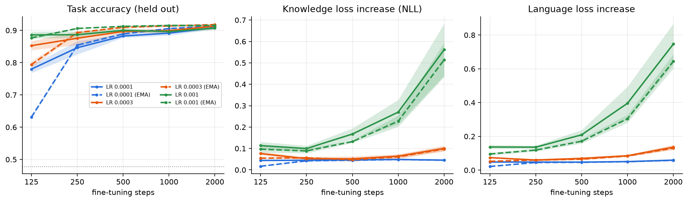

All three learning rates reach the same task accuracy (about 91%) by step 2000. At LR 1e-3, though, knowledge loss
climbs to +0.56 nats and language loss to +0.75, while at 1e-4 both stay flat. The extra damage at the high LR buys
no extra learning. The EMA of the same run (dashed) forgets a little less.

### 2. The noise that training produces is much more harmful than random noise of the same size

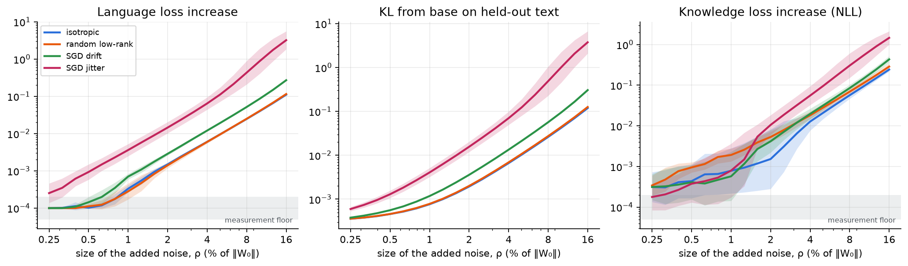

No learning here at all: we add noise to the base weights and measure the damage. Four kinds are compared:
- random Gaussian noise;
- a random low-rank product;
- the **slow drift** of real fine-tunes: the part of the update that differs between seeds and survives an EMA;
- the **fast jitter** of real fine-tunes: raw weights minus their EMA.

Jitter does more damage than random noise of the same size at every size, and the gap widens as the noise grows: on
KL it is about 2× at 0.25% of the weights, 5× at 1%, 10× at 4% and 30× at 16%; language loss shows the same rise. Drift
does about 2–3× the damage of random noise throughout. Random low-rank noise is no worse than random full-rank noise.
The optimizer's own noise is special: it points where the model is sensitive, and its damage grows faster than
quadratically with its size. Knowledge loss shows the same ordering above about 2%; below 1%, the differences are at the
measurement floor (shaded). 19 sizes, 6 seeds, geometric mean ± 95% CI.

### 3. Everything that reduces noise reduces forgetting

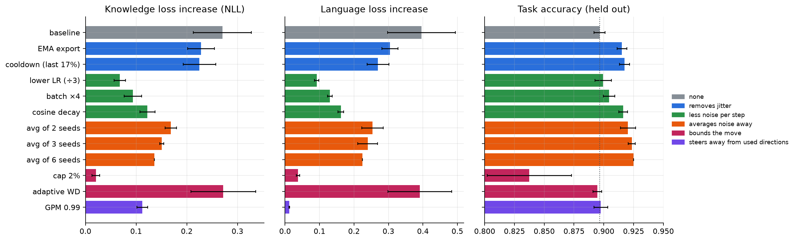

All arms see the same examples. The fixes that make each step less noisy cut knowledge loss 2–4×:
- a lower LR;
- a 4× batch;
- cosine decay.

Averaging the weights of independent runs halves it, and also *raises* task accuracy (89.7% → 92.5% with six seeds).
The noise was hurting the task too. A 2% cap on the distance moved retains the most, but costs task accuracy at this
LR. GPM leaves language untouched (described below). Adaptive weight decay does nothing at this strength; figure 7
sweeps it.

### 4. A single loss spike causes silent, lasting forgetting

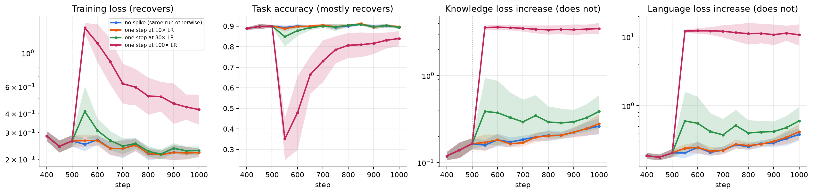

One step at 100× the learning rate, in an otherwise identical run with the same data and the same init:
- training loss recovers within about 100 steps;
- task accuracy climbs back;
- knowledge and language damage stay put for the rest of the run;
- a 30× spike leaves a smaller gap that also never closes.

A recovered training loss says nothing about what was forgotten. In the 2B LoRA runs that motivated this repo, the
same experiment cost 2.7 MMLU points that remained 200 steps later.

### 5. Two mechanisms: large steps, and sampling noise

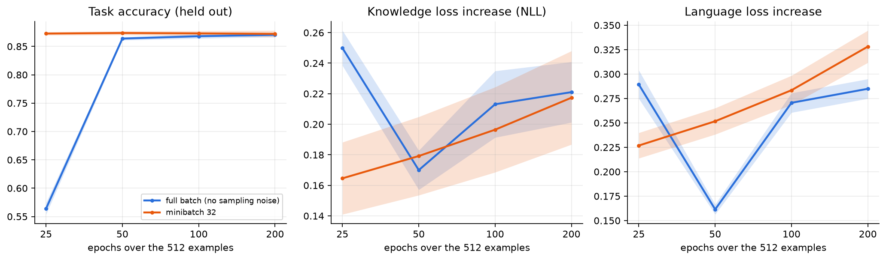

On 512 examples, full-batch AdamW, which has no minibatch noise at all, forgets about as much as minibatch training
at the same task accuracy. So the harmful "noise" is not minibatch sampling as such. Our current reading is that it is
the optimizer's oscillation along sensitive directions at a large step size. Full-batch Adam at a high LR bounces too
(Cohen et al. 2021, edge of stability). That fits figures 1 and 3: the step size matters. A larger batch at a
√-scaled LR gave the damage back in the exploratory runs.

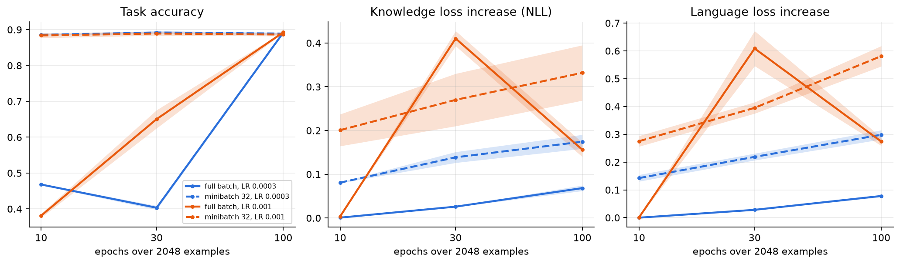

With 2,048 examples (figure 6b) the picture becomes clearer, and there are two mechanisms:
- **Sampling noise does matter.** At the same epochs and task accuracy, minibatch training forgets 2–4× more than
  full-batch training, and its damage keeps accumulating.
- **Step size matters on its own.** Without any sampling noise, full-batch damage roughly doubles from LR 3e-4 to
  1e-3.
- **Full-batch training heals.** It shows a large early transient (knowledge loss 0.41 at 30 epochs at LR 1e-3),
  which it mostly undoes by 100 epochs.

The 512-example case is the special one: the dataset is so small that minibatch noise is weak.

### 6. Higher LoRA rank adds noise, not learning

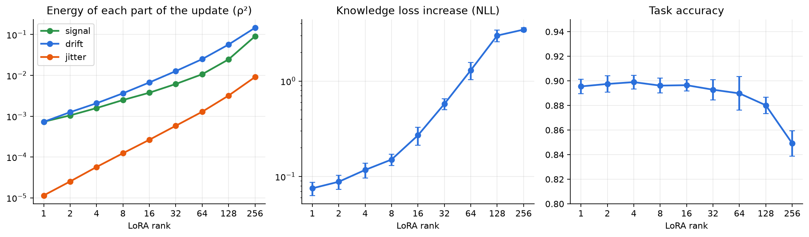

From rank 4 to rank 64:
- the drift and jitter energies grow 12× and 22×;
- seeds agree less;
- task accuracy stays flat;
- knowledge loss grows 11×.

### 7. Distance moved doesn't compare across optimizers; sensitivity-weighted distance does

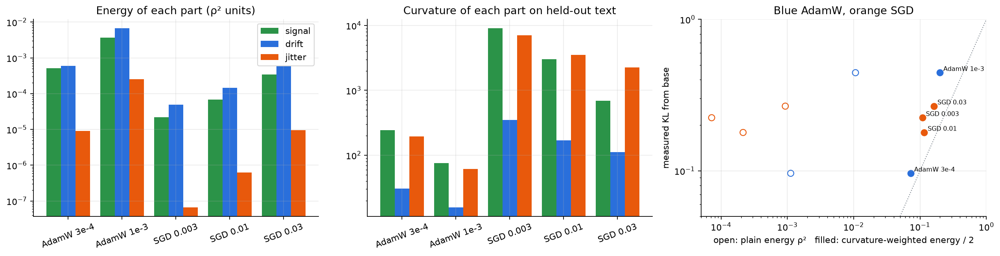

SGD's updates are 10–100× smaller than AdamW's, yet they forget as much, because SGD moves along the sharpest
directions. Weighting each part of the update by its curvature on held-out text puts all five runs close to their
measured KL, where plain distance is off by orders of magnitude. With both optimizers, jitter sits in directions
5–20× sharper than drift.

### 8. Keeping the update out of the directions pretraining uses protects what the model knew

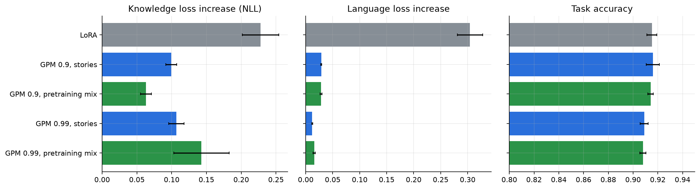

GPM-style projection keeps the adapter's inputs out of the subspace that pretraining activations occupy. With the
same task accuracy as LoRA, it cuts language-loss damage 10–25× and knowledge damage 2–3.6×. Estimating that
subspace from pretraining-mixture text (biographies included) rather than stories alone protects knowledge best at
the 90% setting. The 99% mixture setting is noisier and worse, which is not yet explained.

### 9. Where the update lands decides what each unit of change costs

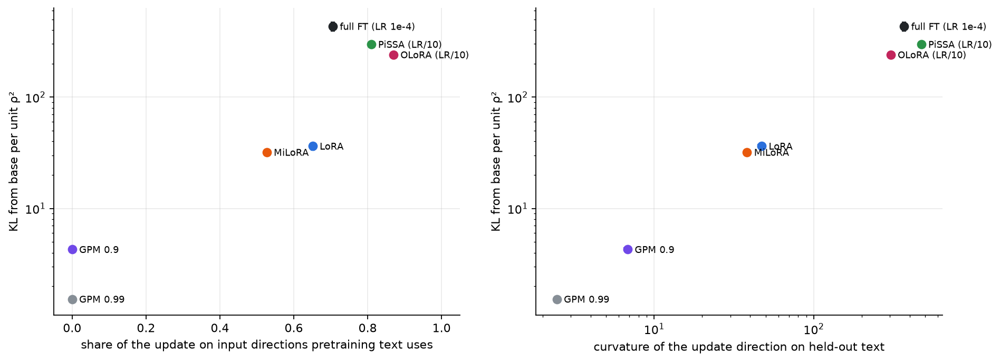

Same task and same task accuracy (about 91%) for every method. The KL per unit ρ² spans more than 100×, ordered by
how much of the update acts on the input directions that pretraining text uses:
- GPM (none of it) is cheapest;
- MiLoRA and LoRA are in the middle;
- PiSSA and OLoRA, which start from the base matrix's principal directions, and full fine-tuning are the most
  expensive.

PiSSA and OLoRA are run at a tenth of the LR here, because their large initial factors otherwise move the weights
much faster. Even matched that way, they cost 6–8× LoRA per unit change. The right panel is close to a consistency
check (KL ≈ ½ · curvature · ρ² for small moves), and it confirms the updates are still in that regime.

### 10. Combined, the fixes remove nearly all of the forgetting

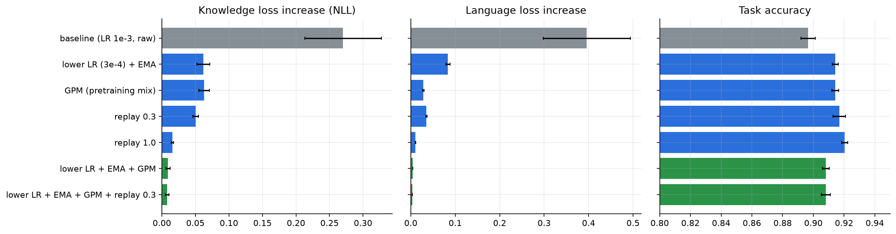

| | knowledge loss | language loss | task |
|---|---|---|---|
| baseline (LR 1e-3, raw weights) | +0.27 | +0.40 | 89.7% |
| lower LR + EMA + GPM | **+0.009** | **+0.004** | 90.8% |

The combination cuts forgetting 30–100× and still beats the baseline on the task. Replay (an LM loss on pretraining
text at every step) also works very well on its own, at weight 1.0: knowledge loss +0.016 and the best task accuracy
(92.0%). The catch is that it needs pretraining-like data at fine-tuning time.

### 11. Noisier labels mean more forgetting at the same distance; a fixed cap holds, adaptive decay only partly

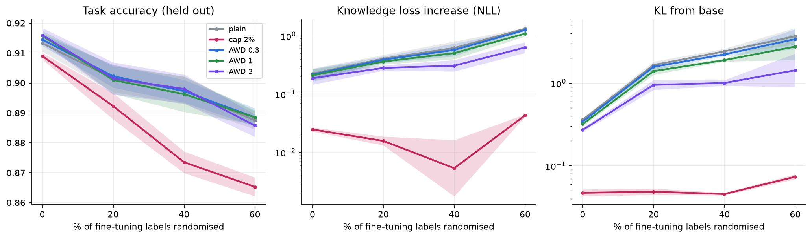

As the share of randomised fine-tuning labels goes from 0% to 60%, plain training's knowledge loss rises about 6×
and its KL about 10×. This happens while the weights move *less* far, so the safe distance depends on data quality.

A fixed 2% cap holds KL at about 0.05 at every noise level, but its task cost grows with the noise (91% → 86.5%).
Adaptive weight decay (Ghiasi et al. 2023, here pulling toward the base with strength ∝ ‖grad‖/‖ΔW‖) helps only at
the strongest setting tried, and only halves the damage at high noise.

### Robustness: the same picture on the yes/no task

Figures 1 and 3 were re-run on the easier yes/no task (`LWN_TASK=badending`, files suffixed `-badending`).
- [Training curves](figures/f1_curves-badending.png): the same shape. Task accuracy is identical across LRs; at
  LR 1e-3, forgetting climbs after step 500.
- [Mitigations](figures/f3_mitigations-badending.png): the same ordering, with smaller absolute damage:
  - lower LR, a 4× batch and a 2% cap cut knowledge loss 4–5×;
  - averaging seeds helps more the more seeds are averaged (0.113 → 0.049 with six);
  - adaptive weight decay does nothing;
  - GPM protects language (+0.007) but not knowledge.
- [Combined fixes](figures/f11_combined-badending.png): lower LR + EMA + GPM cuts knowledge loss from 0.114 to
  0.006 and language loss from 0.124 to 0.003, and task accuracy rises slightly (96.2% → 96.9%). Replay at weight 1.0
  leaves knowledge slightly *better* than the base (−0.012), since it is in effect extra pretraining.

### Robustness: the same picture at 4× the model size

A 27M-parameter base (8 layers, width 512; `LWN_MODEL=large`, files suffixed `-large`) reaches held-out language loss
1.215 and knowledge recall 72% (the 7.4M model reaches 1.355 and 54%).
- [Training curves](figures/f1_curves-large.png): the same shape, with somewhat more forgetting at LR 1e-3 (knowledge
  +0.88, language +1.0 at 2000 steps; +0.04 at LR 1e-4) and a clearer EMA benefit.
- [Mitigations](figures/f3_mitigations-large.png): the same ordering.
  - Knowledge loss falls 5× with a lower LR, 2.7× with a 4× batch and 2× with cosine decay.
  - Averaging six seeds nearly halves it, and task accuracy rises from 89.1% to 91.9%.
  - The 2% cap retains best but costs the most task accuracy.
  - GPM leaves language untouched; adaptive weight decay does nothing.
- [Spikes](figures/f4_spikes-large.png): the same silent forgetting, and the larger model is more fragile.
  - Training loss recovers from 10× and 30× spikes, yet knowledge loss ends 0.07 and 0.20 above the
    identical run without a spike.
  - A 100× spike leaves knowledge loss about 7× the control's and language loss at +8 nats.
- [Combined fixes](figures/f11_combined-large.png): lower LR + EMA + GPM cuts knowledge loss from 0.42 to 0.019 and
  language loss from 0.41 to 0.003. Task accuracy rises from 89.1% to 91.3%.
- [Noise injection](figures/f2_injection-large.png): measured jitter does 10–16× the language damage of random noise
  of the same size, and drift about 3×.
- [GPM](figures/f10_gpm-large.png): cuts language damage 20–50× and knowledge damage 2.5–3.5× at equal task
  accuracy. Estimating the subspace on the pretraining mixture is again best at 0.9.

